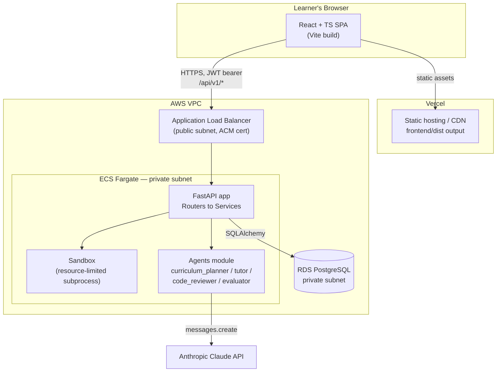
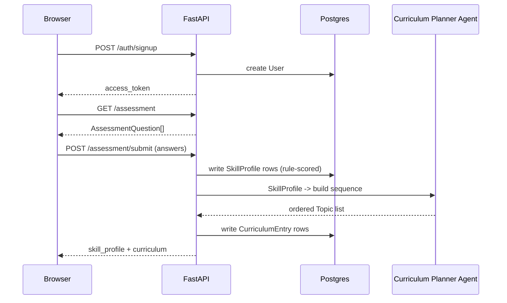
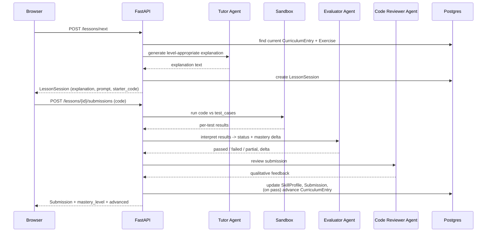
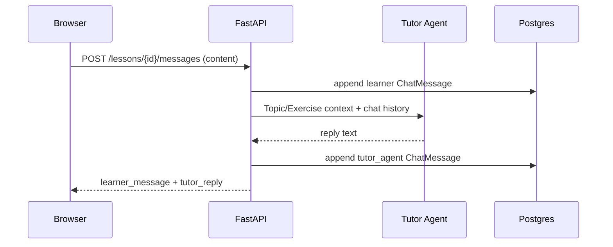
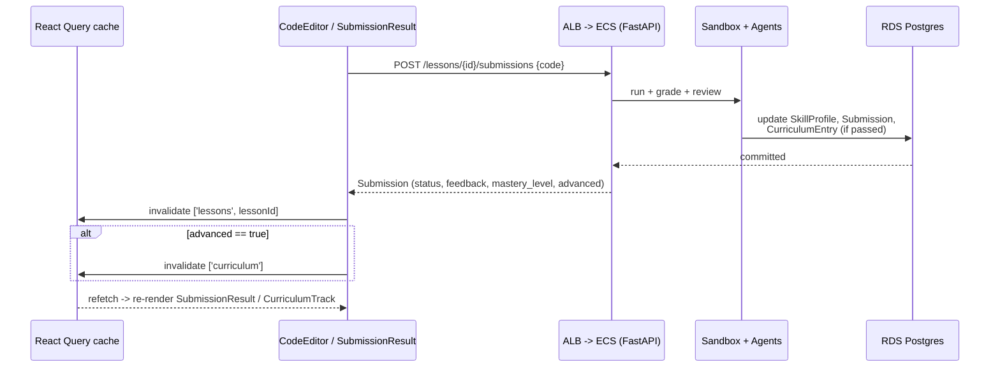
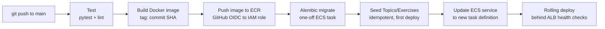
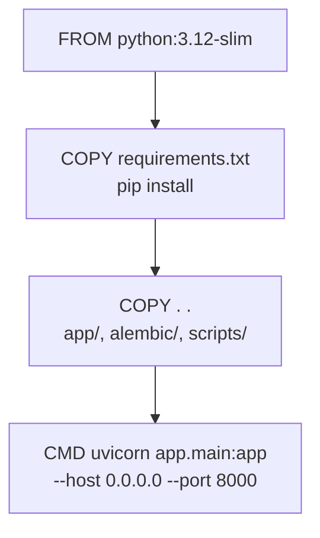
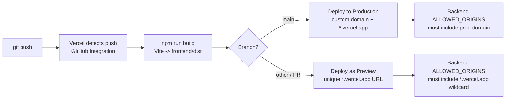

# Architecture Blueprint — Agentic Python Tutor (PyMentor)

> A visual companion to `goal-spec.md`, `backend-spec.md`, `frontend-spec.md`, and `api-contract-spec.md`. This file doesn't introduce new decisions — it diagrams the ones already made in those four specs, so a reader can see the shape of the system before diving into the detail. Keep it under `docs/` alongside them.

## 1. Screen Wireframes

Matches `frontend-spec.md` §3 (Pages/Screens) and §7 (design tokens: Python blue `#306998` / yellow `#FFD43B`, Inter + JetBrains Mono). A rendered version of these three screens was also generated as a Claude design canvas — these ASCII versions are the git-trackable reference.

### 1.1 Login — `/login`
```
┌─────────────────────────────────────────┐
│                                           │
│              [Py] PyMentor               │
│        Your personalized Python tutor    │
│                                           │
│   ┌───────────────────────────────┐     │
│   │ Username                       │     │
│   │ [___________________________]  │     │
│   │ Password                       │     │
│   │ [___________________________]  │     │
│   │                                 │     │
│   │ [          Log In           ]  │     │
│   │ ─────────────────────────────  │     │
│   │  Don't have an account? Sign up│     │
│   └───────────────────────────────┘     │
│                                           │
└─────────────────────────────────────────┘
```

### 1.2 Home / Curriculum — `/curriculum`
```
┌──────────────────────────────────────────────────────────┐
│ [Py] PyMentor                 Logged in as asha | Log out │
├──────────────────────────────────────────────────────────┤
│  Welcome to PyMentor                                      │
│  Your personalized Python curriculum, built from your     │
│  assessment.                                               │
│                                                             │
│  [ Continue Learning — Functions ]                         │
│                                                             │
│  ┌───────────────────────────────────────────────────┐    │
│  │ For Loops                    Completed   ●●●●●     │    │
│  ├───────────────────────────────────────────────────┤    │
│  │ Functions                    Current     ●●○○○     │    │
│  ├───────────────────────────────────────────────────┤    │
│  │ List Comprehensions  (dim)   Locked      ○○○○○     │    │
│  ├───────────────────────────────────────────────────┤    │
│  │ Classes & Objects    (dim)   Locked      ○○○○○     │    │
│  └───────────────────────────────────────────────────┘    │
└──────────────────────────────────────────────────────────┘
```

### 1.3 Lesson — `/lessons/:lessonId`
```
┌────────────────────────────────────────────────────────────────────┐
│ [Py] PyMentor                          Logged in as asha | Log out │
├────────────────────────────────────────────────────────────────────┤
│ ← Back to Curriculum                                                 │
│ ┌────────────────────────────────────┐  ┌──────────────────────┐    │
│ │ FUNCTIONS                          │  │ Ask the Tutor         │    │
│ │ A function lets you package up a   │  ├──────────────────────┤    │
│ │ block of code to reuse...          │  │          "Why do I   │    │
│ ├────────────────────────────────────┤  │  need return here?" ►│    │
│ │ exercise.py                        │  │ ◄ "Without return,   │    │
│ │   def add(a, b):                   │  │    the function...   │    │
│ │       pass                         │  │                       │    │
│ ├────────────────────────────────────┤  │                       │    │
│ │                        [ Submit ]  │  │ [Ask a question…    ]│    │
│ ├────────────────────────────────────┤  └──────────────────────┘    │
│ │ ✓ add(2, 3) → 5                    │                               │
│ │ ───────────────────────────────    │                               │
│ │ "Clean and correct — a             │                               │
│ │  straightforward implementation."  │                               │
│ └────────────────────────────────────┘                               │
└────────────────────────────────────────────────────────────────────┘
```

## 2. System Architecture Blueprint

Matches `backend-spec.md` §1–2 and §6, and `frontend-spec.md` §1/§10.



## 3. High-Level Workflows

### 3.1 Sign up → Assessment → Curriculum
Matches `backend-spec.md` §4 and `api-contract-spec.md`'s `/auth`, `/assessment` endpoints.



### 3.2 Lesson: request, submit, grade
Matches `backend-spec.md` §4 (the core adaptive loop) and `api-contract-spec.md`'s `/lessons/*` endpoints.



### 3.3 Tutor chat
Matches `backend-spec.md` §4 ("Tutor chat") and `api-contract-spec.md`'s `/lessons/{id}/messages` endpoints.



### 3.4 End-to-end: a submission, including frontend cache behavior
Matches `frontend-spec.md` §5 (React Query invalidation rules).



## 4. Docker & Backend Deployment Pipeline

Matches `backend-spec.md` §9 (Environment & Deployment, CI/CD).



What the `Dockerfile` itself does (`backend/Dockerfile`):



## 5. Frontend Deployment Pipeline (Vercel)

Matches `frontend-spec.md` §10.



## 6. Keeping this in sync

- This file is a derived reference, not a fifth source of truth — `goal-spec.md` / `backend-spec.md` / `frontend-spec.md` / `api-contract-spec.md` stay authoritative; this just visualizes them.
- Mermaid blocks render natively on GitHub and in VS Code with the **"Markdown Preview Mermaid Support"** extension (`bierner.markdown-mermaid`) — worth adding to `.vscode/extensions.json` alongside the others.
- When an endpoint, screen, or deployment step changes in the specs, update the matching diagram here in the same commit. A diagram describing a workflow that no longer exists is worse than no diagram.
